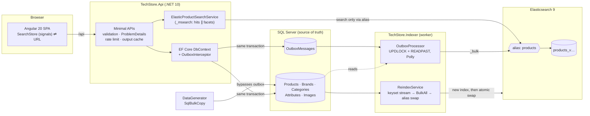

# TechStore

A hardware store whose core is **search**: .NET 10 API + Angular 20 front end, SQL Server as the
source of truth, Elasticsearch 9 as a read model kept in sync through a transactional outbox.

- Typo-tolerant, synonym-aware relevance search with highlighting and "did you mean"
- Correct multi-select facets (post_filter + per-facet filter aggregations)
- Grouped autocomplete (completion suggester + instant results)
- Zero-downtime full reindex (versioned index + atomic alias swap)
- Bulk data generator (SqlBulkCopy, resumable) and k6 load tests

Built from `techstore-search-prompt.md` (the spec). Deviations are listed [at the end](#deviations-from-the-spec).

---

## Run it locally

Everything runs on the machine; only Elasticsearch runs in Docker.

**Prerequisites:** .NET 10 SDK · Node 20.19+ · SQL Server 2022 (Express is fine, Windows auth) · Docker Desktop.

```powershell
# 1. Elasticsearch (security off, synonyms file mounted). Once per machine on Docker Desktop/WSL2:
wsl -d docker-desktop sysctl -w vm.max_map_count=262144
docker compose up -d elasticsearch          # add --profile tools for Kibana on :5601

# 2. API — applies EF migrations and the curated seed (~400 products) on startup
dotnet run --project src/TechStore.Api      # http://localhost:5080, Swagger at /swagger

# 3. Indexer — builds the index on first start (alias "products"), then drains the outbox
dotnet run --project src/TechStore.Indexer

# 4. Web
cd client/techstore-web
npm ci
npm start                                   # http://localhost:4200 (proxies /api to :5080)
```

The connection string defaults to `Server=.\SQLEXPRESS;Database=TechStore;Integrated Security=True`
(`src/TechStore.Api/appsettings.Development.json`). Override any setting with environment variables,
e.g. `ConnectionStrings__Sql`, `Elasticsearch__Url`, `Admin__ApiKey`, `Search__CursorSigningKey`.
Express keeps databases in `Program Files` by default; on a small system drive create the database
elsewhere first (`CREATE DATABASE TechStore ON (FILENAME='D:\TechStoreData\TechStore.mdf' …)`), the
migrations then run against it.

An optional all-in-containers stack exists for completeness: `docker compose --profile full up --build`
(SQL Server, ES, Kibana, API, indexer, nginx-served Angular on :4200).

### Common tasks

| Task | Command |
|---|---|
| Generate products | `dotnet run -c Release --project src/TechStore.DataGenerator -- --count 500000 --batch 50000` |
| Full reindex (CLI) | `dotnet run -c Release --project src/TechStore.Indexer -- --reindex` |
| Full reindex (API) | `POST /api/admin/reindex` with header `X-Api-Key: <Admin:ApiKey>` (queued; the indexer worker runs it) |
| Backend tests | `dotnet test` (unit + integration; integration needs local SQL Server + ES) |
| Front-end tests | `cd client/techstore-web && npx ng test --watch=false --browsers=ChromeHeadless` (set `CHROME_BIN` to Edge/Chrome) |
| Load tests | `K6=path/to/k6 bash tests/load/ladder.sh` |

---

## Architecture



**Write path.** Every product change goes through EF Core; `OutboxInterceptor` adds an
`OutboxMessage` in the same `SaveChanges` (same transaction), so no code path can forget it. The
indexer claims pending rows with `UPDLOCK, READPAST, ROWLOCK` (any number of workers, no double
processing), collapses repeated messages per product, loads current rows with one query, sends a
`_bulk` with Polly exponential backoff + jitter, and only then marks them processed. Rows that keep
failing are dead-lettered after 8 attempts.

**Full reindex.** A new index `products_v{timestamp}` is created with `refresh_interval: -1` and
`number_of_replicas: 0`; products stream from SQL by keyset (`WHERE Id > @last`, never `OFFSET`) into
`BulkAll` (parallel, back-pressured); settings are restored, the index is force-merged, rows changed
*during* the load are re-applied (`UpdatedAt >= start`), and the alias moves in one `_aliases` call.
The API only ever queries the alias. A failed reindex deletes its half-built index; the alias is
untouched (this happened once during development and behaved as designed).

**Read path.** One `_msearch` round trip per search: a scored hits request (relevance, post_filter,
highlight) and a size-0, filter-context facets request (request-cacheable). A second round trip
happens only when results are (nearly) empty: did-you-mean plus the fuzzy fallback.

### Solution layout

```
src/
  TechStore.Domain          entities (init-only), no dependencies
  TechStore.Application     DTOs, interfaces, query parsing/whitelist, FluentValidation, CatalogService
  TechStore.Infrastructure  EF Core + migrations, outbox, ES index/query/sync, curated seed
  TechStore.Api             minimal APIs, rate limiting, output cache, OTel, health, OpenAPI
  TechStore.Indexer         worker: outbox consumer, reindex requests, --reindex CLI
  TechStore.DataGenerator   bulk generator (Bogus over the curated product lines, SqlBulkCopy)
client/techstore-web        Angular 20 (standalone, signals, zoneless), Tailwind v4 + CDK
tests/
  TechStore.UnitTests       parser/validator, query builder, cursor, catalog seed
  TechStore.IntegrationTests real API + SQL + ES: relevance, typos, synonyms, facets, sync, reindex
  load/                     k6 scripts + ladder runner
deploy/elasticsearch/synonyms.txt
```

---

## Search design

### Index (`ProductIndexDefinition.cs`)

| Field | Mapping | Why |
|---|---|---|
| `name` | `text` (product_text) + `.keyword` (lowercase normalizer) + `.suggest` (`search_as_you_type`), `index_options: offsets` | relevance, exact-match boost, instant results; offsets make highlighting cheap |
| `brand`, `category` | `keyword` + `.text` | filters/facets + matching |
| `categoryPath` | `keyword[]` (slugs of the category and its ancestors) | a parent filter (`components`) includes every descendant |
| `brandFacet`, `categoryFacet` | `keyword` `"slug\|Name"` | facet buckets carry their own label |
| `description` | `text`, `index_options: offsets` | matching + fast highlighting |
| `price`, `listPrice`, `discountPrice` | `scaled_float` (×100) | `price` is the effective price used for filters and sorting |
| `popularity`, `ratingBoost` | `rank_feature` | business signals without scripts; ratingBoost = rating × log10(reviews + 10) |
| typed specs | `short`/`integer`/`scaled_float`/`keyword` (`cpuModel`, `gpuModel` are `text` + `.keyword`) | filters and facets |
| `attrs` | `flattened` | long-tail specs without mapping explosion |
| `suggest` | `completion` with a `category` context (ancestors + `_all`), weight from sales | autocomplete |
| `searchText` | `text` via `copy_to` (name, brand, category, cpu, gpu) + `.joined` subfield | cross-field matching ("lenovo laptop") and glued model numbers |
| `dym` | shingled `text` via `copy_to` | phrase suggester source for "did you mean" |

`dynamic: strict`; `_source` is kept (needed for reindex/debug) but every search filters it to the
card fields. No `index.sort`: the default sort is `_score`, which index sorting cannot help, and it
would slow indexing.

### Analyzers — and why the spec's chain was split

The spec asks for one chain: `standard → lowercase → asciifolding → word_delimiter_graph → synonym_graph → stemmer`.
Two problems were found by testing, not assumed:

1. ES rejects it outright: *"Token filter [word_delimiter_graph] cannot be used to parse synonyms"*.
2. Moving `synonym_graph` before `word_delimiter_graph` is accepted, but WDG is not graph-aware and
   flattens the synonym graph. At 500k products **"graphics card" then matched 318,272 documents
   (64% of the catalogue)** and took ~170 ms, because multi-word synonyms degraded into loose ORs.

So the work is divided:

| Analyzer | Chain | Used for |
|---|---|---|
| `product_text` (index) | standard → lowercase → asciifolding → **word_delimiter_graph** → flatten_graph → english | "RTX4090" indexed as `rtx4090, rtx, 4090`; "16GB" as `16gb, 16, gb` |
| `product_text_search` (search) | standard → lowercase → asciifolding → **synonym_graph** → english | proper multi-word synonyms ("graphics card" ⇄ "gpu" ⇄ "video card") |
| `searchText.joined` (index) | standard → lowercase → asciifolding → shingle(2, separator "") | "RTX 4070" also indexed as `rtx4070`, so a glued query matches spaced text |

Result: "rtx4070" ⇄ "RTX 4070" and "16gb" ⇄ "16 GB" match both ways, synonyms stay precise
("graphics card" now matches only what it should), and synonyms remain search-time only — editing
`synonyms.txt` needs `POST /products/_reload_search_analyzers`, not a reindex.

### Relevance (`ProductQueryBuilder.MainQuery`)

```
bool
  must:   one of —
            multi_match best_fields, operator AND over name^5, brand.text^3, category.text^2,
                        gpuModel^3, cpuModel^3, description
            match searchText (AND)            ← terms spread over fields ("lenovo laptop")
            match searchText.joined (AND)     ← glued model numbers ("rtx4070")
  should: match_phrase name (slop 1, ×4) · term name.keyword (×10) ·
          rank_feature popularity (saturation, ×2) · rank_feature ratingBoost (×1.5) · term inStock
  filter: every selected filter (non-scoring)
```

Sorts: relevance (`_score`, then sales), price ↑/↓, rating, newest, best-selling — each ends with
`id` as a unique tiebreaker so `search_after` cursors are deterministic. `?explain=true` (Development
only) returns per-hit score explanations.

### Typo tolerance

Fuzzy matching (`fuzziness: AUTO, prefix_length: 1, max_expansions: 50, fuzzy_transpositions: true`)
is applied only to text fields. Two strategies are implemented behind `Search:TypoStrategy`:

- **`fallback` (default)** — exact query first; when it returns fewer than 3 hits, a relaxed fuzzy
  query (`minimum_should_match: 3<75%`) runs in a second round trip.
- **`combined`** — one query: exact clause ×3 OR fuzzy clause.

Benchmark (see [Load test results](#load-test-results)): `fallback` p95 60 ms vs `combined` 133 ms at 40 RPS, and better results — `fallback` is the default.

The fuzzy pass tries query terms both stemmed and unstemmed: the English stemmer can move a typo away from the indexed form ("moniter" → "monit", 2 edits from "monitor") or towards it ("assus" → "assu", 1 edit from "asu").

"Did you mean" uses a phrase suggester on the shingled `dym` field and is requested only when results
are few (< 5). Suggestions that only rewrite numbers ("iphone 16 pro 256" → "… 216") or only re-space
a token ("wifi" → "wi fi") are discarded.

### Filters and facets (`FacetConfig.cs`)

- All filters are non-scoring `bool.filter` clauses of the hits request (see the post_filter A/B in
  the load results); filter keys are whitelisted server-side
  (`SearchFields`) — unknown keys return a 400 ProblemDetails.
- Facets: category, brand, price (range buckets + min/max for the slider), rating (4.5+/4+/3+),
  in-stock, and category-specific spec facets configured in **one place** (`FacetConfig`), e.g.
  laptops → RAM/storage/CPU brand/GPU/screen/refresh; monitors → size/refresh rate.
- **Multi-select done correctly:** each facet aggregation is wrapped in a `filter` agg containing
  every *other* active filter; the selected category instead scopes the whole facet request, and the
  category facet is computed by a second small request without it. Selecting ASUS keeps every other brand visible with its true count;
  integration tests assert the counts equal what you'd get by switching filters.
- `terms` aggregations are capped (`size 30`, `shard_size 55`); a selected value that falls outside
  the top 30 still gets its bucket through a small `sel` sub-aggregation.

### Autocomplete

`GET /api/products/autocomplete?q=rog str&category=laptops` — one ES request containing a
completion suggester (fuzzy, `skip_duplicates`, category context) and 4 instant results
(`multi_match bool_prefix` over `name.suggest` and its shingles). Brands and categories are matched
in memory against a small reference snapshot (32 brands, 22 categories, refreshed every 5 minutes)
with the same AUTO-style typo tolerance — no aggregation per keystroke. Minimum 2 characters;
ASP.NET output cache (30 s, varied by `q` and `category`).

### Highlighting and XSS

`<mark>` tags, `fragment_size: 150`, 2 fragments, `require_field_match: false`, and
`encoder: html` — ES HTML-encodes the source, so `<mark>` is the only markup that can come back.
The SPA renders highlights through `SafeMarkPipe`, which escapes every `<`/`>` that is not an exact
`<mark>`/`</mark>`, and Angular sanitises `[innerHTML]` again. An integration test indexes a product
named `<script>…</script> <b>Mouse</b>` and asserts the highlight comes back encoded.

### Pagination

`from/size` for pages 1–50 (validated). Every response carries an opaque, **HMAC-signed**
`nextCursor` (`search_after` sort values + text mode + a fingerprint of the query). The first cursor
request opens a point-in-time; later cursors carry its id, and an expired PIT is reopened
transparently. A cursor replayed against different filters is rejected (400).

### API hardening

ProblemDetails everywhere (ES failures → 503 "Search is temporarily unavailable"; aborted requests
are not logged as errors), FluentValidation, Brotli/Gzip compression, token-bucket rate limiting per
client (search 20/s, autocomplete 30/s by default), output caching, `CancellationToken` passed into
every ES call (a superseded keystroke cancels its ES request), one singleton `ElasticsearchClient`,
System.Text.Json source generation for all payloads, OpenTelemetry tracing (ASP.NET, HTTP, SQL, ES
`took` as a span attribute; OTLP exporter when `OpenTelemetry:OtlpEndpoint` is set), `/health`
(SQL + ES) and `/health/live`.

---

## Front end

Angular 20 (standalone components, signals, new control flow, zoneless), Tailwind v4 for tokens and
layout, Angular CDK for focus trapping. Tailwind instead of Material: the visual identity is custom,
and Material would have had to be overridden rather than used.

- **`/`** — hero search with grouped autocomplete (debounce 150 ms, `distinctUntilChanged`,
  `switchMap` cancels in-flight requests, ↑ ↓ Enter Esc, ARIA combobox), category grid, best
  sellers, new arrivals.
- **`/products`** — the same search box in the header; collapsible facet groups with counts, price
  slider + inputs, rating, in-stock switch, "show more", active filter chips with "clear all", sort,
  result count ("10,000+ results"), did-you-mean, empty state with next steps, skeleton loaders,
  pagination; the facet panel becomes a focus-trapped drawer under 1024 px.
- **URL is the state.** `SearchStore` derives everything from the query string; actions only
  navigate. Refresh, shared links and back/forward reproduce the exact view.
- **Design:** the palette comes from the hardware itself — aluminium chassis, silkscreen white,
  solder-mask green for actions, and **Kapton-tape amber** as the signature: wherever the user's
  query matched (suggestions, titles, snippets, active filters) it is "taped over". Product images
  are line drawings with silkscreen reference designators (`VGA1`, `DIMM1`, `U1`). Archivo (expanded)
  for display, Public Sans for text, JetBrains Mono for specs and prices. Light and dark themes,
  visible focus, reduced motion respected.

---

## Data generation

`TechStore.DataGenerator` reuses the curated product lines (real models with variant axes: CPU, GPU,
RAM, storage, colour…) and samples them with **Bogus**: category weights mirror a real catalogue,
listings get marketplace variants ("Renewed", "(2025)", "Bundle"…), prices spread ±10% around the
line price, ratings/reviews/sales follow skewed distributions.

- **Fast:** `SqlBulkCopy` with `TableLock`, products + attributes per batch in one transaction.
- **Resumable & idempotent:** every row is a pure function of `(seed, index)` with SKU
  `GEN-000000001…`; a rerun continues after the last committed batch, a finished run is a no-op.
- **Safe ids:** ids are reserved from the same HiLo sequence EF uses (`sp_sequence_get_range`), so
  generated rows never collide with app-created products.
- It bypasses the outbox by design and prints the reindex command to run afterwards.

Measured: **500,000 products in ~7 s per 50k batch (~8,000 rows/s steady state)**. Each run's first
batch stalled for ~4–5 minutes on this machine before reaching that rate (seen on 2 of 3 runs);
the cause was not identified — `sys.dm_os_waiting_tasks` during the first batch is the next step.
With PAGE compression (migration `PageCompression`) 500k products + 1.27M attributes use
**320 MB** in SQL Server, so even 10M would fit Express's 10 GB limit.

---

## Load test results

Run on the developer laptop that also hosts everything else — **Intel i7-9850H (6C/12T), 15.8 GB RAM
(~2 GB free during tests), Windows 11**; ES 9.5.3 in Docker/WSL2 (1.5 GB heap, 1 shard, 1 segment),
SQL Server 2022 Express, API in Release/Production, k6 2.3 on the same machine, Rider open.
Catalogue: **500,394 products** (557 MB index). 60 s per run, constant arrival rate, after warm-up.
Scripts: `tests/load/search.js` (text queries incl. ~10% typos, some brand filters, sorts, pages 2–5),
`facets.js` (category pages with multi-select brands/specs/price/rating/stock, mostly no text),
`autocomplete.js` (typed prefixes).

### Final results (all targets met at the stated rates)

| Scenario | Rate | p50 | p95 | p99 | Target | |
|---|---|---|---|---|---|---|
| Search | 40 RPS | 12.7 ms | **59.9 ms** | 167.7 ms | p95 < 150 ms | ✅ |
| Facet-heavy search | 40 RPS | 6.1 ms | **175.7 ms** | 264.5 ms | p95 < 250 ms | ✅ |
| Autocomplete, output cache **off** (every call hits ES) | 200 RPS | 3.2 ms | **7.7 ms** | 15.7 ms | p95 < 50 ms | ✅ |
| Autocomplete, output cache on (30 s) | 200 RPS | 0.0 ms | 0.7 ms | 3.8 ms | p95 < 50 ms | ✅ |

0 failed requests in every run. Raw summaries: `tests/load/results/` (git-ignored; regenerate with `ladder.sh`).

### How we got there (measured, same machine)

| Change | Search p95 @ 40 RPS | Facets p95 @ 40 RPS |
|---|---|---|
| First version (2 shards, WDG after synonyms) | 249 ms | — |
| Analyzer split (synonyms no longer flattened), `_msearch` hits ∥ facets, did-you-mean only on few results | 343 ms (2 shards) → **187 ms** (1 shard) | — |
| 1 shard, force-merged, reproducible from code | 110 ms | 471 ms |
| Selected filters in the hits query's `bool.filter` instead of `post_filter` | **60 ms** | 285 ms |
| Category filter scopes the facet request; category facet computed separately | 59 ms | **176 ms** |

The `post_filter` → `bool.filter` change is a deliberate deviation from the spec's wording: facets are a
separate request in the same `_msearch`, so the hits request has no aggregations to protect, and
`post_filter` only made ES score every text match (or, with no text, the whole catalogue) before
discarding it. A/B with everything else equal (measured with a temporary switch, since removed): facets p50 23 ms /
p95 221 ms vs **6 ms / 176 ms** — identical results, asserted by the multi-select integration tests.

**Typo strategy benchmark** (search.js, same rates):

| Strategy | p95 @ 25 RPS | p95 @ 40 RPS | Quality |
|---|---|---|---|
| **fallback** (chosen) | 52 ms | **60 ms** | exact results for normal queries; typos get the relaxed pass + did-you-mean |
| combined | 128 ms | 133 ms | the fuzzy clause runs on every query and floods results ("assus rog" → 10,000+ loose matches, no did-you-mean) |

### Caveats and what would change in production

- Everything (load generator, API, SQL, ES, an IDE) shares one 6-core laptop with ~2 GB free RAM, so
  these numbers are a floor, not a ceiling. The first run after a reindex is slower (cold caches):
  search p95 was 198 ms at 15 RPS before the page cache warmed, 110 ms afterwards.
- Facet p95 is dominated by unique filter combinations over large categories (request-cache misses).
  At larger scale: dedicated data nodes with the index in the filesystem cache, a replica per extra
  node for read throughput, coordinating nodes for the `_msearch` fan-out, and an external cache for
  hot category landing facets.
- The fuzzy pass was refined after the final ladder (query terms are now tried stemmed *and*
  unstemmed, fixing "moniter" → monitors). It only runs when the exact pass finds < 3 hits.

---

## Shard sizing and scaling

**Measured document size:** 557 MB for 500,394 documents (one force-merged segment) ≈ **1.1 KB/doc**.

| Catalogue | Primary data | Primaries (20–40 GB each) | Replicas | Notes |
|---|---|---|---|---|
| 500k (tested) | 0.56 GB | **1** | 0 locally | 2 shards were measurably slower on one busy node (p95 343 ms vs 187 ms at 40 RPS) — extra per-shard query, fetch and reduce work with no spare CPU to parallelise |
| 10M | ~11 GB | **1** (2 for parallelism on dedicated hardware) | 1–2 | fits one shard; replicas add read throughput |
| 100M | ~110 GB | **4–6** | 1–2 | dedicated nodes (below) |

**Growing to 100M:** dedicated master-eligible nodes (3, small); data nodes sized so the index fits
the filesystem cache; coordinating-only nodes in front for `_msearch` fan-out and reduce; replicas
for read throughput rather than more primaries; the facet request becomes the dominant cost on broad
queries, so hot landing/category facets move to an external cache (Redis, see deviations) and very
broad result sets can use `random_sampler` for approximate counts. ILM is not needed: a catalogue is
not time-series. Reindexing stays the same (alias swap); `BulkAll` parallelism and SQL keyset
streaming scale linearly, and the generator's page compression keeps SQL small.

---

## Design decisions and trade-offs

| Decision | Trade-off |
|---|---|
| ES queries built as JSON (`System.Text.Json.Nodes`) and sent through the official client's transport; typed API used for `BulkAll` | reads 1:1 with the ES docs and is unit-testable as JSON; less compile-time checking of the DSL |
| Outbox written by an EF `SaveChangesInterceptor` | impossible to forget; requires all writes to go through EF (the generator deliberately doesn't and is followed by a reindex) |
| Product ids from a HiLo sequence | ids exist before `SaveChanges` (outbox in the same transaction) and the generator can reserve ranges; ids are not contiguous |
| Hits and facets as two searches in one `_msearch` | parallel execution and request-cacheable facets; facets of the fuzzy fallback cost a second round trip only on (near-)empty results |
| `fallback` typo strategy | 2× faster p95 than `combined` and precise results; typos cost a second round trip |
| Selected filters in `bool.filter` (not `post_filter`) | facets are a separate request, so this is result-identical and much cheaper; differs from the spec's wording |
| In-memory brand/category matching for autocomplete | instant and typo-tolerant; reference data is ≤ 5 minutes stale |
| Signed cursors with query fingerprint | cursors can't be tampered with or replayed on another search; cursors are opaque and longer |
| Force-merge after full reindex | fastest search (one segment); reindex takes longer (~6 extra minutes at 500k on this machine) |
| Init-only domain entities | values set after construction (timestamps, SKU/slug derived from the HiLo id) go through EF's change tracker (`entry.Property(..).CurrentValue`) |

---

## Deviations from the spec

| Spec | Here | Why |
|---|---|---|
| Angular latest (22) | **Angular 20.3** | Angular 22 needs Node ≥ 22.22; the machine stays on Node 20.19 (owner's choice) |
| Redis for hot autocomplete/landing facets | **skipped** | owner's choice; ES shard request cache + ASP.NET output cache cover the hot paths for now |
| Docker Compose brings everything up; Testcontainers | **local services** (SQL Server Express, ES-only compose); integration tests use a throwaway database and alias on the local servers | the project is not deployed; owner prefers local installs. Compose `--profile full` remains optional |
| 10M products load-tested | **500k** | SQL Server Express (10 GB cap) and very limited disk space on this machine; "enough data to test" (owner) |
| Spec's single analyzer chain | split index/search analyzers + joined subfield | the chain is rejected by ES, and the accepted variant breaks synonyms (measured) |
| `post_filter` for selected facet filters | `bool.filter` in the hits request; facets in a separate request of the same `_msearch` | result-identical, measured p95 221 → 176 ms on facet browsing |
| FluentAssertions | **7.2.x** | v8+ requires a commercial licence |
| `vm.max_map_count` | documented, not automated | Docker Desktop resets it on restart |
